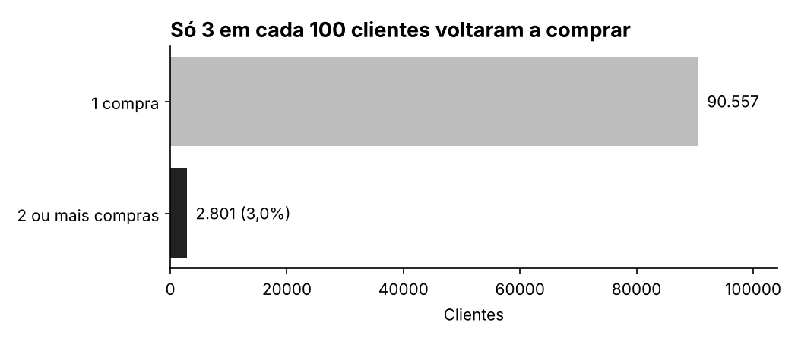
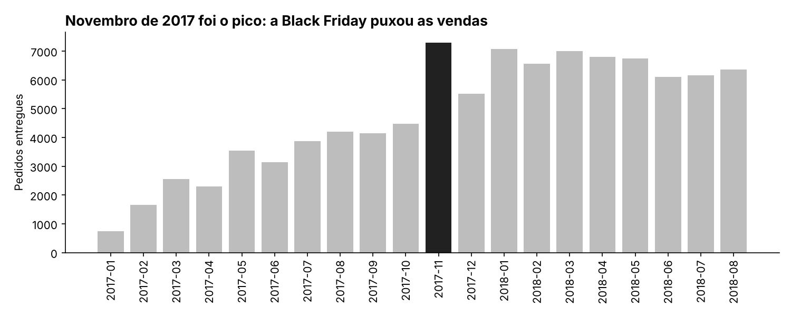

# Análise exploratória de um e-commerce brasileiro (Olist)

Análise de cerca de 100 mil pedidos reais do marketplace Olist (2016 a 2018), feita com Python e Pandas.

Trabalho com CRM e marketing de ciclo de vida. Por isso olhei a base com perguntas de retenção: quem volta a comprar, quando compra e o que estraga a experiência.

**[Abrir o notebook completo](notebooks/analise_exploratoria.ipynb)**

## Principais achados

| Pergunta | Resposta |
|---|---|
| Como as vendas evoluíram? | Crescimento forte em 2017, pico na Black Friday (7.289 pedidos em nov/2017) e patamar de 6 a 7 mil pedidos por mês em 2018 |
| Quantos clientes voltam a comprar? | Só 3,0% compraram mais de uma vez |
| Quando o cliente compra? | Segunda e terça são os dias mais fortes. 81,5% dos pedidos acontecem entre 10h e 22h |
| Atraso afeta a avaliação? | Nota média de 4,29 no prazo contra 2,27 com atraso |
| Onde está a receita? | 10 categorias concentram 62% da receita |

### 97% dos clientes compraram uma única vez



### Atraso na entrega derruba a nota


### A Black Friday de 2017 foi o pico de vendas



## Recomendações

1. **Atacar a recompra primeiro.** Com 97% de clientes de compra única, uma régua de segunda compra tem o maior potencial de retorno.
2. **Avisar o cliente antes do atraso.** O atraso é raro (6,8% dos pedidos), mas derruba a nota.
3. **Concentrar testes de comunicação no começo da semana**, quando o cliente já compra mais.

## O que foi feito

- Leitura de 5 tabelas e verificação de qualidade (campos vazios, duplicados e tipos de dado).
- Tratamento: conversão de datas, filtro de pedidos entregues e corte dos meses incompletos.
- Junção de tabelas com `merge` e resumo com `groupby`.
- Cuidado com armadilhas da base: o cliente real é o `customer_unique_id`, e alguns pedidos têm mais de uma avaliação.
- 6 gráficos, cada um com uma única mensagem.

## Limites da análise

- A base é uma amostra e cobre cerca de dois anos. A recompra real pode ser maior em um prazo mais longo.
- A relação entre atraso e nota é uma associação. Os dados não provam causa sozinhos.

## Como rodar

```bash
pip install -r requirements.txt
python baixar_dados.py
jupyter notebook notebooks/analise_exploratoria.ipynb
```

## Estrutura

```
├── notebooks/analise_exploratoria.ipynb   análise completa, com resultados
├── imagens/                               gráficos gerados pelo notebook
├── dados/                                 tabelas (baixadas pelo script)
├── baixar_dados.py                        baixa a base pública
└── requirements.txt                       bibliotecas usadas
```

## Fonte dos dados

[Brazilian E-Commerce Public Dataset by Olist](https://github.com/olist/work-at-olist-data), base pública e anonimizada.

## Próximos passos

- Segmentação de clientes por RFM em SQL (PostgreSQL).
- Modelo de previsão de recompra com Scikit-learn.
