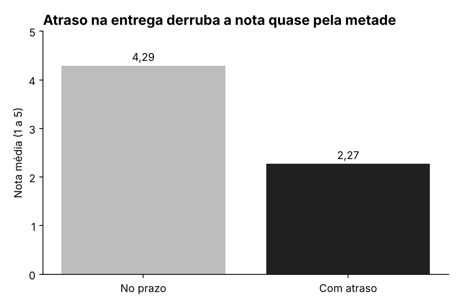
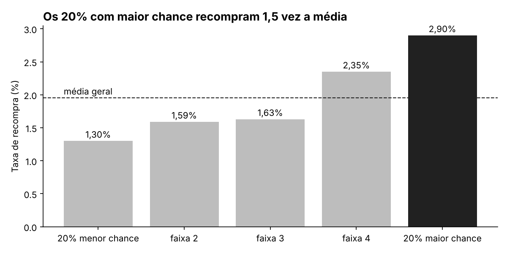

# Análise de clientes de um e-commerce brasileiro (Olist)

Estudo de cerca de 100 mil pedidos reais do marketplace Olist (2016 a 2018).

Trabalho com CRM e marketing de ciclo de vida. Por isso olhei a base com perguntas de retenção: quem volta a comprar, o que estraga a experiência, com quem vale a pena falar primeiro e se dá para prever a recompra.

| Parte | O que responde | Ferramentas |
|---|---|---|
| [1. Análise exploratória](notebooks/analise_exploratoria.ipynb) | O que aconteceu com as vendas e os clientes? | Python, Pandas, Matplotlib |
| [2. Segmentação RFM](sql/README.md) | Com quem vale a pena falar primeiro? | SQL, PostgreSQL |
| [3. Previsão de recompra](notebooks/previsao_recompra.ipynb) | Dá para prever quem vai voltar? | Python, Scikit-learn |

# Parte 1: análise exploratória

**[Abrir o notebook completo](notebooks/analise_exploratoria.ipynb)**

## Principais achados

| Pergunta | Resposta |
|---|---|
| Como as vendas evoluíram? | Crescimento forte em 2017, pico na Black Friday (7.289 pedidos em nov/2017) e patamar de 6 a 7 mil pedidos por mês em 2018 |
| Quantos clientes voltam a comprar? | Só 3,0% compraram mais de uma vez |
| Quando o cliente compra? | Segunda e terça são os dias mais fortes. 81,5% dos pedidos acontecem entre 10h e 22h |
| Atraso afeta a avaliação? | Nota média de 4,29 no prazo contra 2,27 com atraso |
| Onde está a receita? | 10 categorias concentram 62% da receita |

### 97% dos clientes compraram uma única vez


### Atraso na entrega derruba a nota



### A Black Friday de 2017 foi o pico de vendas


## Recomendações

1. **Atacar a recompra primeiro.** Com 97% de clientes de compra única, uma régua de segunda compra tem o maior potencial de retorno.
2. **Avisar o cliente antes do atraso.** O atraso é raro (6,8% dos pedidos), mas derruba a nota.
3. **Concentrar testes de comunicação no começo da semana**, quando o cliente já compra mais.

## O que foi feito

- Leitura de 5 tabelas e verificação de qualidade (campos vazios, duplicados e tipos de dado).
- Tratamento: conversão de datas, filtro de pedidos entregues e corte dos meses incompletos.
- Junção de tabelas com `merge` e resumo com `groupby`.
- Cuidado com armadilhas da base: o cliente real é o `customer_unique_id`, e alguns pedidos têm mais de uma avaliação.
- 6 gráficos, cada um com uma única mensagem.

## Limites da análise

- A base é uma amostra e cobre cerca de dois anos. A recompra real pode ser maior em um prazo mais longo.
- Dos 2.801 clientes com mais de um pedido, 808 só fizeram novos pedidos nas primeiras 24 horas. A recompra em outro dia é de 2,1% (detalhe na Parte 3).
- A relação entre atraso e nota é uma associação. Os dados não provam causa sozinhos.

## Como rodar

```bash
pip install -r requirements.txt
python baixar_dados.py
jupyter notebook notebooks/analise_exploratoria.ipynb
```

# Parte 2: segmentação RFM em SQL

**[Abrir a documentação completa](sql/README.md)**

Separei os 93.358 clientes em 7 segmentos por recência, frequência e valor, com consultas em PostgreSQL.

- **30% dos clientes geram 57% da receita.** São os dois segmentos de alto valor.
- **13.888 clientes de alto valor estão em risco.** Compraram uma vez, gastaram bem e estão há 6 a 12 meses sem voltar. É a prioridade 1 de reativação.
- **Só 1,3% dos clientes são campeões**, com mais de uma compra e ainda ativos.


# Parte 3: previsão de recompra

**[Abrir o notebook completo](notebooks/previsao_recompra.ipynb)**

Treinei um modelo para estimar, depois da primeira compra, a chance de o cliente voltar em até 180 dias.

**O modelo ficou fraco, e essa é a resposta.** Os dados da primeira compra dizem pouco sobre quem volta.

| Medida | Resultado |
|---|---|
| Clientes na base do modelo | 55.261 |
| Taxa de recompra em 180 dias | 1,95% |
| AUC da regressão logística (0,5 é sorteio) | 0,585 no teste e 0,572 na validação cruzada |
| Recompra nos 20% com maior chance | 2,90%, ou 1,5 vez a média |



O que este projeto mostra:

- **Definição cuidadosa do alvo.** Separei recompra de verdade de carrinho dividido no mesmo dia.
- **Cuidado com o tempo.** Só entram clientes que tiveram 180 dias para voltar.
- **Avaliação honesta.** Um modelo que sempre diz "não recompra" acerta 98% e não serve para nada. Por isso usei AUC e a taxa por faixa.
- **Recomendação de negócio.** Não usar o modelo sozinho. Usar o RFM da Parte 2 e buscar dados de comportamento, como abertura de e-mail e visita ao site.

# Estrutura

```
├── notebooks/analise_exploratoria.ipynb   parte 1, com resultados
├── notebooks/previsao_recompra.ipynb      parte 3, com resultados
├── sql/                                   parte 2: consultas e documentação
├── imagens/                               gráficos das três partes
├── dados/                                 tabelas (baixadas pelo script)
├── baixar_dados.py                        baixa a base pública
├── carregar_postgres.py                   cria as tabelas e carrega os dados
├── rodar_rfm.py                           roda o RFM e gera os gráficos
└── requirements.txt                       bibliotecas usadas
```

# Fonte dos dados

[Brazilian E-Commerce Public Dataset by Olist](https://github.com/olist/work-at-olist-data), base pública e anonimizada.
