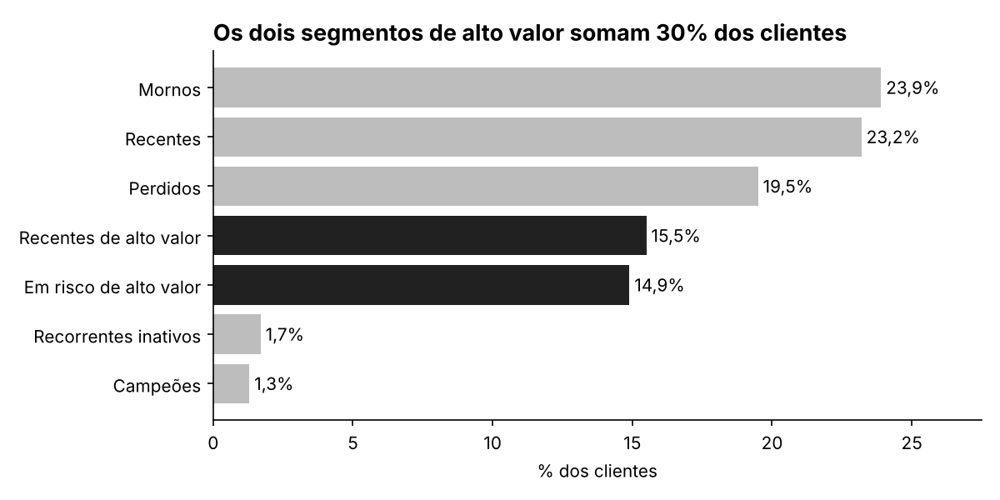
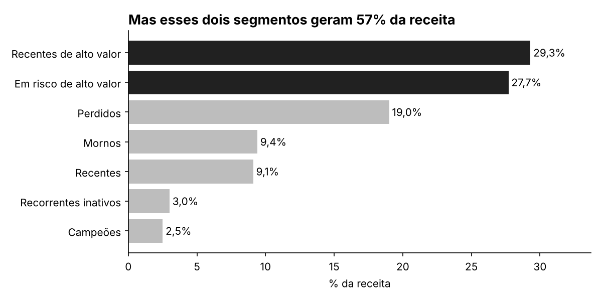

# Parte 2: segmentação RFM em SQL (PostgreSQL)

Na [Parte 1](../README.md) descobri que só 3% dos clientes voltam a comprar. Aqui respondo a pergunta seguinte: **com quem vale a pena falar primeiro?**

Para isso, separei os 93.358 clientes em 7 segmentos usando RFM, direto no banco de dados.

## O que é RFM

É uma forma de dar três notas para cada cliente:

- **R (recência):** há quantos dias foi a última compra.
- **F (frequência):** quantos pedidos fez.
- **V (valor):** quanto gastou.

## Resultado

| Segmento | Clientes | % dos clientes | Receita (R$) | % da receita | Gasto médio (R$) | Recência média (dias) |
|---|---:|---:|---:|---:|---:|---:|
| Recentes de alto valor | 14.479 | 15,5% | 3.867.446,58 | 29,3% | 267,11 | 92 |
| Em risco de alto valor | 13.888 | 14,9% | 3.660.858,15 | 27,7% | 263,60 | 268 |
| Perdidos | 18.236 | 19,5% | 2.517.802,07 | 19,0% | 138,07 | 474 |
| Mornos | 22.292 | 23,9% | 1.244.288,67 | 9,4% | 55,82 | 269 |
| Recentes | 21.662 | 23,2% | 1.202.693,89 | 9,1% | 55,52 | 90 |
| Recorrentes inativos | 1.600 | 1,7% | 403.251,00 | 3,0% | 252,03 | 320 |
| Campeões | 1.201 | 1,3% | 325.157,75 | 2,5% | 270,74 | 89 |
| **Total** | **93.358** | **100%** | **13.221.498,11** | **100%** | **141,62** | |

### 30% dos clientes geram 57% da receita





## O que fazer com cada segmento

| Segmento | Quem é | Ação de CRM |
|---|---|---|
| Em risco de alto valor | Gastou bem, comprou uma vez e está há 6 a 12 meses sem voltar | **Prioridade 1.** Régua de reativação com oferta. São 13.888 clientes e R$ 3,7 milhões em histórico |
| Recentes de alto valor | Gastou bem e comprou nos últimos 6 meses | **Prioridade 2.** Régua de segunda compra, antes que esfriem |
| Campeões | Comprou mais de uma vez e segue ativo | Reconhecer e manter. Programa de relacionamento |
| Recorrentes inativos | Já comprou mais de uma vez, mas sumiu | Reativação personalizada pelo histórico |
| Recentes | Compra recente de valor baixo | Venda cruzada para aumentar o ticket |
| Mornos | Valor baixo e sem compra há meses | Comunicação de baixo custo |
| Perdidos | Mais de um ano sem comprar | Última tentativa e, sem resposta, tirar das réguas |

## Como as notas foram calculadas

| Nota | Regra |
|---|---|
| R | `NTILE(5)`: os clientes são divididos em 5 grupos do mesmo tamanho. Nota 5 para a compra mais recente |
| V | `NTILE(5)`: nota 5 para quem mais gastou |
| F | Regra fixa: 1 pedido = nota 1, 2 pedidos = nota 3, 3 ou mais = nota 5 |

**Por que a frequência não usa `NTILE`?** Porque 97% dos clientes têm um pedido só. O `NTILE` obrigaria a dividir essas pessoas iguais em notas diferentes, por sorteio. A regra fixa é mais honesta com os dados.

Faixas que saíram do `NTILE`:

| Nota | Recência (dias desde a última compra) | Valor gasto (R$) |
|---:|---|---|
| 5 | até 93 | a partir de 179,90 |
| 4 | 93 a 178 | 109,90 a 179,90 |
| 3 | 178 a 269 | 69,90 a 109,90 |
| 2 | 269 a 383 | 39,90 a 69,90 |
| 1 | 383 ou mais | até 39,90 |

## Regras dos segmentos

O `CASE` testa as regras nesta ordem e para na primeira verdadeira.

| Ordem | Regra | Segmento |
|---:|---|---|
| 1 | F ≥ 3 e R ≥ 4 | Campeões |
| 2 | F ≥ 3 | Recorrentes inativos |
| 3 | R ≥ 4 e V ≥ 4 | Recentes de alto valor |
| 4 | R ≥ 4 | Recentes |
| 5 | R ≥ 2 e V ≥ 4 | Em risco de alto valor |
| 6 | R ≥ 2 | Mornos |
| 7 | o que sobrou (R = 1) | Perdidos |

## Recursos de SQL usados

- `WITH` (CTE) para quebrar a consulta em passos nomeados.
- `INNER JOIN` entre três tabelas.
- `GROUP BY` com `COUNT`, `SUM`, `MAX` e `AVG`.
- Funções de janela: `NTILE(5) OVER (...)` e `SUM(...) OVER ()`.
- `CASE WHEN` para as regras de negócio.
- Chaves primárias e estrangeiras na criação das tabelas.

## Arquivos

| Arquivo | O que faz |
|---|---|
| [01_criar_tabelas.sql](01_criar_tabelas.sql) | Cria as tabelas `customers`, `orders` e `order_items` |
| [02_segmentacao_rfm.sql](02_segmentacao_rfm.sql) | Calcula o RFM e cria a tabela `clientes_rfm` |
| [03_resumo_segmentos.sql](03_resumo_segmentos.sql) | Resume cada segmento |

## Como rodar

É preciso ter o PostgreSQL instalado e um banco vazio criado. Rode os comandos na pasta principal do projeto.

```bash
pip install -r requirements.txt
python baixar_dados.py

export PGHOST=localhost PGUSER=postgres PGPASSWORD=sua_senha PGDATABASE=olist

python carregar_postgres.py
python rodar_rfm.py
```

## Conferência

Os totais do SQL batem com os da Parte 1, feita em Pandas: 93.358 clientes, R$ 13.221.498,11 em receita e 2.801 clientes com mais de um pedido.

## Limites da análise

- A data de referência é o dia seguinte ao último pedido da base (30/08/2018), não a data de hoje.
- Clientes com a mesma recência ou o mesmo valor podem cair em notas vizinhas na fronteira do `NTILE`.
- Os nomes e as regras dos segmentos são uma escolha de negócio. Outra empresa poderia cortar diferente.
